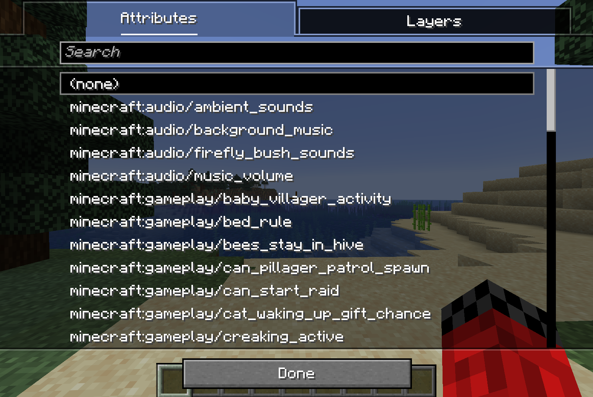

A new snapshot fixing a 7-year old dragon bug and several secret debug options.

## Ice Ball

Ice Ball damage was reduced from $$\lceil 1.395 \cdot \text{velocity} \rceil$$ to $$\lceil 1.3 \cdot \text{velocity} \rceil$$.

## Ender Dragon

When the Ender Dragon is moving towards a target, such as a player during its dive attack or the End podium, the dragon's vertical velocity is now scaled by 0.1 (exactly `0.10000000149011612` due to floating-point precision) instead of the old, incorrect value 0.01, fixing {::bug:MC-272431}. Fixing this bug also fixed {::bug:MC-197201}, {::bug:MC-271336}, and {::bug:MC-271337}.

## Debug Properties

Launching the game with `-DMC_DEBUG_ENABLED` enables several debug features relating to environment variables:

### Environment Attribute Options

A new screen accessible through F3+5 (configurable). The "Attributes" tab is used to select the environemnt attribute to debug in `environment_attribute` and `visualize_environment_attribute`. The "Layers" tab enables/disables specific layers for the selected environment attribute, such as disabling the biome layer to prevent biomes from overriding background music.

Disabled by the `reduced_debug_info` gamerule.

### `environment_attribute` Debug Screen Text

Shows the selected environment variable's default value, layer modifiers and values after modification, and final resulting value.

Environment attributes are evaluated at the player's feet position in first-person, or the camera position in third-person.

Disabled by the `reduced_debug_info` gamerule.

### `visualize_environment_attribute` Debug Renderer

Visualizes the selected environment variable's values in a 16-block radius by assigning each value a different color.

The Y level to evaluate environment variables at is determined by the player's feet position in first-person, or the camera position in third-person.

Disabled by the `reduced_debug_info` gamerule.

### `/environmentattribute`

Added the `/environmentattribute <attribute> get [<pos>]` command, which evaluates an environment attribute:
- `<attribute>`: The environment attribute
- `<pos>`: The position to evaluate the environment attribute at

Requires operator level 2.

## Dedicated Servers

The `pattern` command argument matches a **case-sensitive** regular expression starting at the pattern argument and ending at the end of the command. `^` and `$` match these bounds. Command parsing continues at the end of the first match.

For example, if the command is `/match <pattern> <count>`, and the user types `/match text 5`, then the regular expression will attempt to match `text 5`. If the regular expression is `\w+`, then `text` is matched and parsing continues at `5`, making the command `/match <pattern=text> <count=5>`.

